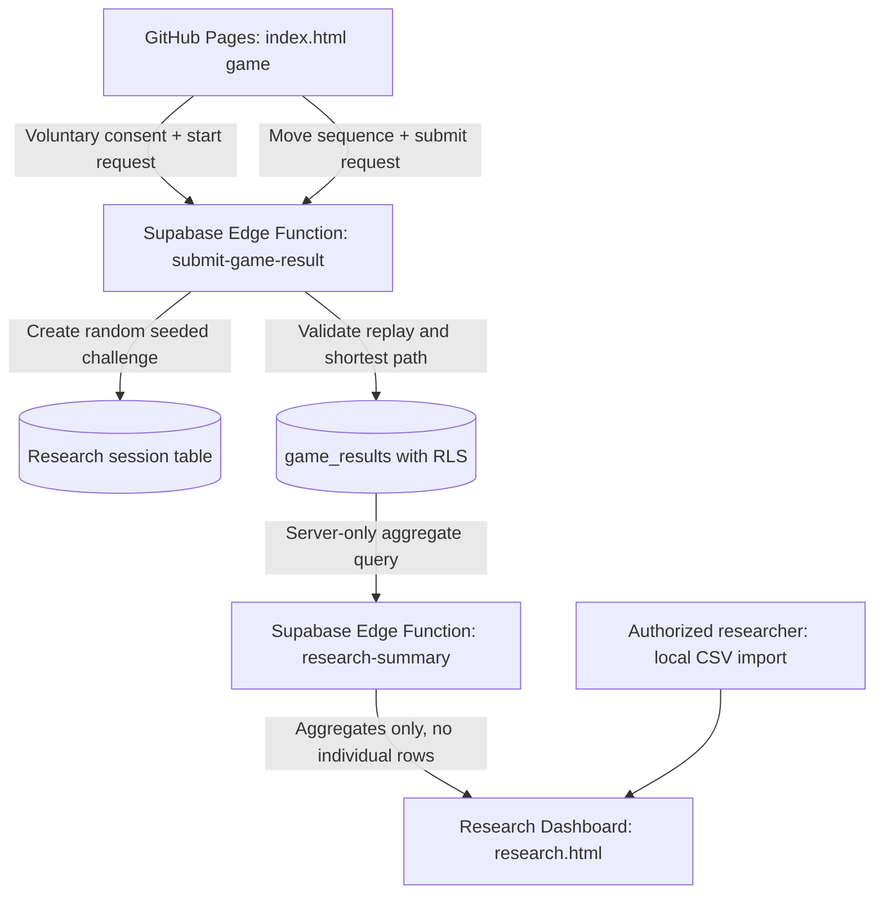

🧠 Algorithm Lab
An interactive pathfinding laboratory and exploratory human problem-solving study.
▶ Play Algorithm Lab · 📊 Research Dashboard
Algorithm Lab is a bilingual (Azerbaijani/English), browser-based maze game that brings together graph search algorithms, reproducible experiments, and an opt-in study of human pathfinding efficiency.
> **Project status:** Working software and pilot research infrastructure. Research findings are preliminary until data collection, consent procedures, cleaning, and analysis are complete. Do not present test submissions as research participants.
What you can do
Feature	Description
🎮 Play a maze	Navigate procedurally generated 9×9, 13×13, and 17×17 mazes with keyboard or touch controls.
🔎 Explore algorithms	Visualize BFS, DFS, and A* searching the same maze.
⚖️ Compare methods	Compare explored cells and route lengths, with runtime estimates in Research Mode.
🧪 Reproducible benchmarks	Run 5, 10, or 20 seeded mazes, then export trial-level data as CSV.
🤝 Voluntary research	After opting in and completing a server-generated maze, share an anonymous performance result.
📊 Research Dashboard	View aggregate research metrics and locally analyze CSV exports.
🌐 AZ / EN	Switch between Azerbaijani and English.
Algorithms
Algorithm	Time complexity*	Space complexity*	Shortest path?
BFS	O(V + E)	O(V)	Yes, in unweighted graphs
DFS	O(V + E)	O(V)	Not guaranteed
A*	Implementation/heuristic dependent	Implementation/heuristic dependent	Yes, with an admissible, consistent heuristic and correct implementation
Standard graph-search bounds; actual JavaScript implementation details (array-backed queues/priority selection) affect measured runtime. A uses the Manhattan-distance heuristic, which is appropriate for four-directional unit-cost grid movement.*
Research question
How does maze size relate to human pathfinding efficiency when compared with BFS shortest paths?
The primary measure for a completed game is:
[
\mathrm{Path\ Efficiency}\ (%) = \frac{\mathrm{BFS\ optimal\ steps}}{\mathrm{player\ steps}}\times 100.
]
Secondary metrics include completion time, extra steps above optimal, and the percentage of games following an optimal route.
Research limitations
The database records completed game submissions, not verified unique participants.
Maze size does not alone measure maze difficulty: maze layout and route complexity vary.
Participants may submit more than one game. Abandoned runs are not part of the completed-game dataset.
Server checks the submitted move sequence against a server-generated maze, but cannot verify the player is human.
Historic development/test results must be excluded from research conclusions when identifiable.
Timing depends on device and environment; algorithm microbenchmarks are not controlled hardware comparisons.
Extra consent and institutional/guardian safeguards may be required when recruiting minors.
System architecture

Security boundaries: No service-role or secret token is placed in client-side HTML. The game's public anon JWT is a publishable credential, not user authentication or anti-bot protection. Direct anonymous read/write access to `game_results` must stay blocked by database grants and RLS. The dashboard’s public endpoint returns aggregates with a minimum group threshold; the raw CSV stays inside the researcher's browser during local analysis.
Research dashboard
The dashboard provides submitted games, mean path efficiency, mean completion time, optimal-route percentage, per-size comparison, daily trend, and filters by date, maze size, and software version. It supports a local Supabase CSV import and export of aggregated statistics. The live summary requires deploying the optional `research-summary` Edge Function.
Repository files
```text
index.html                          # Game (includes iPhone double-tap zoom fix)
research.html                       # Standalone analytics dashboard
supabase/functions/research-summary/index.ts  # Read-only aggregate API
PRIVACY_AND_RESEARCH.md             # Research and consent documentation template
SETUP_AZ.md                         # Short Azerbaijani installation instructions
README.md                           # This documentation
```
The pre-existing v5.1 `submit-game-result` function and SQL protections are not modified by this dashboard update.
Local use
Open `index.html` in a browser. For deployed use, serve the files through GitHub Pages. The dashboard’s local CSV analysis requires no server; the live metrics feature requires the new Supabase Edge Function. See SETUP_AZ.md.
Responsible research and privacy
The game requests opt-in consent before data submission. No name or email is requested by the game, although infrastructure providers can retain technical logs. Do not publicly expose the individual submission table. Research involving minors needs appropriate review, consent safeguards, and a published retention/privacy policy before recruiting participants. See PRIVACY_AND_RESEARCH.md.
Screenshots
> Add verified screenshots of the game, BFS/DFS/A* visualization, batch experiments, and the research dashboard. Do not use mock charts as if they were observed results.
Acknowledgments and transparency
Implemented with HTML, CSS, JavaScript, Supabase, and GitHub Pages. Document all contributors and any AI-assisted implementation accurately, and ensure that you can explain and test the code you publish.
Project maturity
The application and data collection infrastructure are functional; a statistical research paper is not yet completed. Publish empirical findings only after a documented data-cleaning and analysis procedure.
